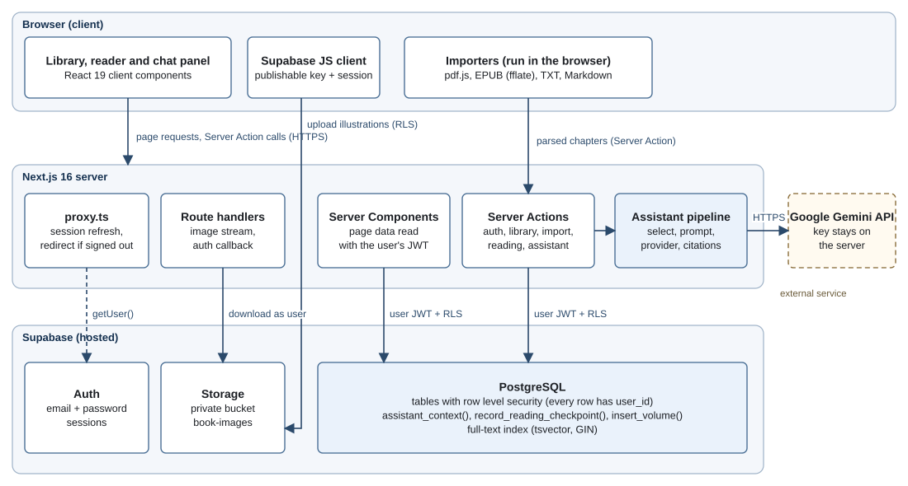
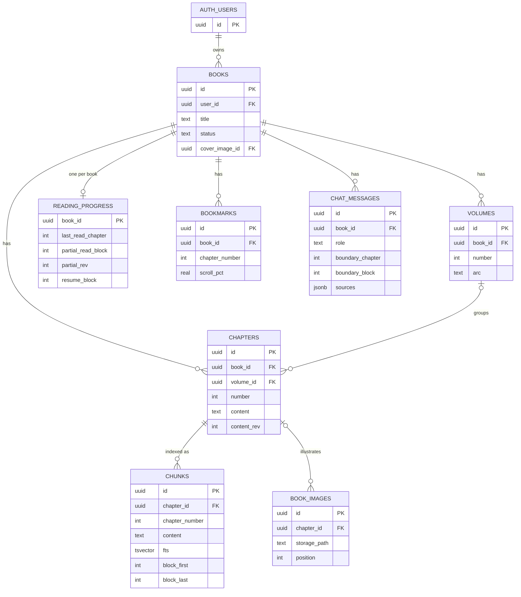
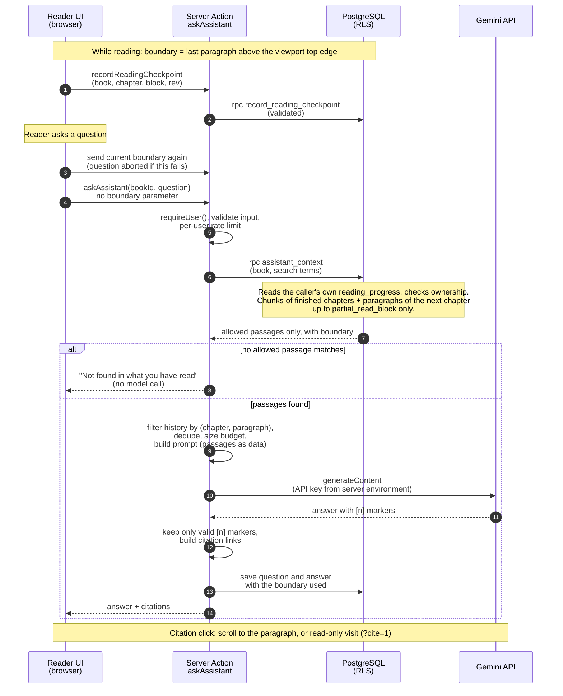

# Recall: Project Architecture

**Course:** CSS447 &nbsp;|&nbsp; **Deliverable:** Project Architecture (individual project) &nbsp;|&nbsp; **Author:** [Your name, student ID] &nbsp;|&nbsp; **Date:** October 2026 &nbsp;|&nbsp; **Repository state described:** commit `cf3d8b4` (branch `main`)

> **About this document.** The official assignment instructions and rubric were not available when this report was written. The structure follows common software-architecture deliverables and is not claimed to be an official requirement. Every statement about the system is based on the repository (code, migrations, README, tests). Status labels are used consistently: **Implemented** (code present and covered by automated tests), **Partial**, **Planned** (not in the repository), and **Unverified** (code exists but was not checked against a live service in this work). No live Supabase project, live Gemini call or browser session was exercised while preparing this report.

## 1. Project overview

**Problem.** Readers of long novels and light-novel series (dozens of volumes, hundreds of chapters, large casts) forget characters, relationships and earlier events between reading sessions. Asking a general AI assistant or searching the web is risky: answers readily contain spoilers for events the reader has not reached, and a general assistant knows nothing about the reader's own copy or progress.

**Target users.** Individual readers who keep their own legally obtained reading material (EPUB, PDF, plain text or Markdown files) and want to (a) keep a personal library, (b) read with remembered position, and (c) ask "who is this character?" or "what happened with the gate?" and get an answer based only on what they have already read.

**Objectives.**
1. Provide a personal library of books, volumes and chapters, owned by one account.
2. Import volumes from files, preserving chapter structure and inline illustrations.
3. Provide a reader with chapter navigation, bookmarks, progress and resume position.
4. Provide an in-reader AI chat that answers from the reader's already-read text, with citations.
5. Guarantee, by design and not by prompt alone, that unread text never reaches the AI model.
6. Run at zero cost (free tiers only).

**Scope.** In scope: single-user accounts, personal libraries, file import, reader, retrieval over the user's own text, one AI provider (Google Gemini, free tier). Out of scope: distributing or scraping copyrighted text, social features, native mobile apps, paid services, OCR for scanned PDFs, vector (embedding) search.

**Proposed solution.** Recall is a full-stack web application. A Next.js server renders pages and exposes Server Actions; Supabase supplies authentication, a PostgreSQL database and private file storage. Security-critical rules (who can read which rows, and which passages the assistant may retrieve) are enforced inside the database with row-level security (RLS) and SQL functions. The Gemini API is called only from the server, with excerpts that the database has already filtered to the reader's boundary.

## 2. Requirements and system architecture

**Functional requirements and current status**

| ID | Requirement | Status |
|---|---|---|
| F1 | Email/password sign-up, sign-in, sign-out; pages under `/library` require a session | Implemented |
| F2 | Library of books with status, covers, volumes (including decimal volumes such as 4.5) and chapters | Implemented |
| F3 | Import volumes from EPUB, PDF, TXT and Markdown, with chapter editing before saving | Implemented (PDF without a text layer is detected; no OCR) |
| F4 | Inline illustrations and covers stored privately and shown in reading order | Implemented |
| F5 | Reader: chapter picker, previous/next, bookmarks, text size/font/width, resume position | Implemented |
| F6 | Best-effort metadata import from a Ranobelib URL (title and details only, no chapter text) | Partial (depends on a third-party page; not guaranteed) |
| F7 | In-reader AI chat with follow-ups and citations that jump to the cited paragraph | Implemented; Gemini live behaviour Unverified |
| F8 | Spoiler protection at chapter level and at paragraph level inside the current chapter | Implemented; verified by automated tests only (see section 5) |

**Non-functional requirements**

| Quality | How the architecture addresses it |
|---|---|
| Security | RLS on every table; per-user storage folders; no service-role key anywhere in the app; boundary computed inside the database; Gemini key held only in server environment variables. |
| Privacy | Book text stays in the user's own rows. Only the question, a few short permitted passages and bounded history leave for Google. On the free tier Google may use submitted content to improve its products (stated in the UI and README). |
| Reliability | Provider failures are mapped to safe error codes; no model call when no permitted passage matches; a question is cancelled if the reading position cannot be saved. |
| Usability | Reader keeps the exact paragraph when text size, window width or the chat panel change; chat is a side panel (desktop) or bottom sheet (mobile). |
| Maintainability | Pure, unit-tested modules for rules (boundary, chunking, citations); provider interface isolates Gemini; migrations are ordered SQL files. |
| Cost | Free tiers only; capped answer length, passage count, context size and history; per-user request limits. |

**Architecture style.** Recall is a *layered, server-centred web application on a backend-as-a-service platform*. The Next.js server is the only application server; there is no separate API service. Server Actions act as the application layer, Supabase PostgreSQL is the persistence and policy layer, and the AI provider sits behind an interface (a ports-and-adapters pattern). This fits a one-person project: one deployable, no custom authentication, and security rules that live next to the data, so a bug in a page cannot bypass them.

Figure 1. System architecture: components and their relationships.

## 3. Components and technology stack

**Reader and library UI** (Next.js 16.4 App Router, React 19.3, Tailwind CSS 4, TypeScript). *Responsibility:* library, book page, reader, chat panel, importers. *Inputs:* data from Server Components, user gestures, local files. *Outputs:* Server Action calls and direct storage uploads. The reader measures paragraphs (`data-block`) and reports the reading boundary.

**Server layer** (Server Actions in `app/actions/*.ts`, route handlers for image streaming and the auth callback, `proxy.ts`). *Responsibility:* validate input with Zod, authenticate with `requireUser()`, call Supabase as the signed-in user, run the assistant pipeline. *Inputs:* validated requests with the session cookie. *Outputs:* typed results (`ActionResult`) and streamed images. `proxy.ts` refreshes the session and redirects signed-out visitors away from `/library` (an optimistic check only; real authorization is in `lib/auth.ts` and RLS).

**Authentication and authorization** (Supabase Auth, `@supabase/ssr`). Email/password sessions are held in cookies. Authorization is row-level: policies compare `user_id` to `auth.uid()`, and child tables also require that the referenced book belongs to the user.

**Database and data access** (Supabase PostgreSQL, `@supabase/supabase-js`). Seven ordered migrations create eight application tables, indexes, RLS policies and SQL functions. All queries go through the user's JWT, so RLS applies to every read and write. Complex or security-sensitive operations are `SECURITY INVOKER` SQL functions (`insert_volume`, `assistant_context`, `record_reading_checkpoint`).

**File import and text processing** (`pdfjs-dist`, `fflate`, custom parsers in `lib/`). PDF, EPUB, TXT and Markdown are parsed *in the browser*; the user reviews and edits the chapter structure; then chapter text is saved through Server Actions (body limit raised to 2 MB) and split into passages (`chunks`) with their paragraph ranges. A chapter's text is a list of *blocks* (one non-empty line each; illustrations are `[[image:uuid]]` markers).

**Image storage** (Supabase Storage, private bucket `book-images`). Illustrations and covers are uploaded by the browser under `<user_id>/<book_id>/<image_id>`; storage policies allow only the owner's folder. Pages display them through a server route that reads the object as the user.

**AI provider and retrieval pipeline** (`@google/genai`, `lib/assistant/*`). *Responsibility:* turn a question into search terms, retrieve permitted passages, build a prompt, call Gemini, validate citations. Details in section 5.

| Component | Technology (version from `package.json`) | Responsibility | Status |
|---|---|---|---|
| Web framework | Next.js 16.4.0, React 19.3.0, TypeScript 5, Tailwind 4 | Pages, reader, chat UI, Server Actions | Implemented |
| Authentication | Supabase Auth, `@supabase/ssr` 0.12.7 | Sessions, sign-in/up, route protection | Implemented; live project Unverified |
| Database | Supabase PostgreSQL, `@supabase/supabase-js` 2.117.3 | Data, RLS, SQL functions | Implemented; migrations 0005 to 0007 on a live project Unverified |
| Import | `pdfjs-dist` 6.4.299, `fflate` 0.8.3, custom parsers | EPUB/PDF/TXT/MD to chapters and images | Implemented |
| Metadata import | `cheerio` 1.2.0, `lib/import/ranobelib.ts` | Best-effort title/metadata from a URL | Partial |
| Image storage | Supabase Storage (private bucket) | Illustrations and covers | Implemented; live bucket Unverified |
| Retrieval | PostgreSQL full-text search (`simple` config, GIN index, `ts_rank_cd`) | Rank permitted passages | Implemented |
| AI provider | `@google/genai` 2.29.1, default model `gemini-3.5-flash-lite` | Grounded answer generation | Implemented behind an interface; live calls Unverified |
| Validation | Zod 4.6.7 | Input validation in Server Actions | Implemented |
| Testing | Vitest 5, PGlite 0.5.9 (in-process Postgres) | Unit, SQL and RLS tests with a fake AI provider | Implemented; 403 tests passed in a run on 15 Oct 2026 |
| Vector search | pgvector embeddings | Semantic retrieval | Planned |

## 4. Data architecture

Figure 2. Entity-relationship diagram of the implemented schema (migrations 0001 to 0007; key columns only). Every table except auth.users also carries a user_id foreign key to auth.users; covers are referenced by books.cover_image_id and volumes.cover_image_id.

**Main entities** (all from `supabase/migrations/0001` to `0007`).
- `books` belong to a user; they own `volumes` (unique number per book, optional arc, per-volume cover) and `chapters`. A chapter's `number` is the series-wide reading order and is the unit of the chapter-level boundary; `volume_id` only groups chapters.
- `chapters.content` holds the text. `content_rev` is bumped by a trigger whenever the text changes, so a saved paragraph position is valid only for the text revision it was recorded on.
- `chunks` are the retrieval passages (the passages of the search index), with a generated `tsvector` column and, for new imports, the paragraph range they cover.
- `reading_progress` has one row per book (primary key `book_id`): finished chapters (`last_read_chapter`), the paragraph boundary inside the next chapter (`partial_read_block` with `partial_rev`), and resume data.
- `bookmarks`, `book_images` (metadata; the bytes are in the private Storage bucket and referenced by `storage_path`) and `chat_messages` (each message stores the boundary it was produced under and its citations).
- `auth.users` is managed by Supabase; it is not created by Recall's migrations.

**User data isolation.** Every application table has `user_id default auth.uid()` and RLS enabled. The `books` policy is `user_id = auth.uid()`; each child policy additionally checks that the referenced book belongs to the user. Storage policies require the first path segment to equal `auth.uid()`. SQL functions are `SECURITY INVOKER`, so RLS stays in force inside them. Tests with two simulated users (PGlite) check that one user cannot read or change the other's books, progress or passages.

**Proposed additions (not in the repository).** (1) `chunks.embedding vector` with a pgvector index for hybrid semantic retrieval; (2) a dedicated rate-limit table instead of counting `chat_messages` rows; (3) an optional persisted paragraph table if per-paragraph indexing is ever needed. None of these exist today.

## 5. AI chat data flow and spoiler protection

Figure 3 shows one chat question from the reader's scroll report to the rendered answer; the text below explains the boundary rule and how it is enforced.

**Boundary rule.** The *intended design* and the *current implementation* agree: text above the top edge of the reading viewport is read; the first visible paragraph and everything below it is unread. Details of the implementation: a 24 px margin keeps a paragraph that has only just scrolled off from counting; the paragraph is identified by its block number, never by pixels, so font size, layout and loading pictures cannot corrupt it; the boundary can move backward and forward; and only the chapter after the last finished one can have a partial position. A chapter is marked finished only by "Next chapter" or "Mark chapter finished", never automatically.

**How exclusion works.** The browser never sends a boundary with a question. `assistant_context(book, terms)` is a `SECURITY INVOKER` function that (1) reads the caller's own `reading_progress` row, (2) checks the book belongs to the caller, (3) returns ranked passages from chapters `<= last_read_chapter`, and (4) for the next chapter computes hits directly from `chapters.content`, limited to blocks `<= partial_read_block` and only if `partial_rev` equals the chapter's current `content_rev`. If no position is stored, or the text changed, none of the current chapter is used (fail closed). Text beyond the boundary never leaves the database, so neither the prompt nor the system instruction is relied on to hide it.

**Gemini integration.** `askAssistant` (a Server Action) sends the question, at most 8 passages within a 6000-character budget, and bounded history (3000 characters) to Gemini through a provider interface. The key is read from `GEMINI_API_KEY` on the server. Replies cite passages as `[n]`; the server keeps only markers that match supplied passages and builds citation links from retrieval metadata, not from model text.

Figure 3. Sequence of one chat question in the current implementation.

**Threats and mitigations**

| Threat | Mitigation in the architecture | Unresolved risk |
|---|---|---|
| Manipulated client progress | Question carries no boundary; progress is written through `record_reading_checkpoint`, which checks ownership, that the chapter is the next in line, that the paragraph exists and that the text revision matches; chapter progress advances one chapter at a time. | The owner can still edit their own `reading_progress` row through the Supabase API, and the browser's paragraph report is trusted within the next chapter. This can only widen what that same user sees. |
| Cross-user data access | RLS on all tables, per-user storage folders, ownership check inside functions, two-user tests. | Tests use an emulated `auth` schema in PGlite; behaviour on the live Supabase project is Unverified. |
| Prompt injection in imported text | Book text is placed only in `<source>` data blocks, tag-like text is neutralised, rules tell the model to treat sources as data, the model is given no tools, answers are rendered as plain text, citations are server-built. | A model can still be influenced by hostile text; impact is limited to answers about text the reader already has. |
| API-key exposure | Key only in server environment (not `NEXT_PUBLIC_`); never sent to the browser, stored or logged (errors reduced to codes); `.env.local` is git-ignored. | Hosting-platform secret management is not specified in the repository. |
| Leakage through history or citations | Each message stores `(boundary_chapter, boundary_block)`; history and the displayed chat drop anything produced under a later or unknown position; citations come only from retrieved passages. | A message answered before the reader scrolled back is hidden, not deleted. |
| Model prior knowledge | System rules forbid outside knowledge. | **Cannot be enforced**: a model may know a famous story and leak it. This is the main unresolved risk. |

## 6. Deployment, decisions and trade-offs

**Development and deployment.** The repository contains no deployment configuration (no Dockerfile, CI workflow or hosting manifest), so a production host is **not specified and not verified**. Local development is `npm run dev` against a hosted Supabase project; `npm run build` produces a Node server build (Cache Components are enabled; pages that read cookies are wrapped in `Suspense`). Database changes are applied by running the migration files, in order, in the Supabase SQL editor.

**Secrets and configuration.** `.env.local` (git-ignored) holds `NEXT_PUBLIC_SUPABASE_URL` and the publishable key, which are public by design and protected by RLS, plus the server-only `GEMINI_API_KEY` and optional `ASSISTANT_*` limits. `.env.example` contains placeholders only. No service-role key is used.

**Request flow.** Browser to Next.js (cookie session refreshed in `proxy.ts`); Server Components and Server Actions call Supabase with the user's JWT; illustrations are uploaded browser-to-Storage under RLS; only `askAssistant` calls Gemini, from the server, after the database has returned the permitted passages.

**Key decisions and trade-offs**

| Decision | Reason | Trade-off |
|---|---|---|
| Enforce spoilers in SQL, not in prompts | A prompt cannot guarantee secrecy; unread text must never be sent | Retrieval logic lives in SQL, harder to evolve than application code |
| PostgreSQL full-text search first | Free, no extra service, fast, exact names and terms work well in fiction, and it is easy to restrict by chapter and paragraph in one query | Weaker on paraphrased or conceptual questions; hence vector/hybrid search is a planned improvement |
| Parse files in the browser | Avoids server upload limits and keeps the free hosting load low | Large PDFs depend on the user's device |
| Boundary from scroll position | No manual confirmation; simple rule | Trusts the client within the next chapter; layout shifts can only lower the boundary |
| Provider interface for AI | Model or vendor can change; tests use a fake provider | One more abstraction layer |
| No separate API service | One deployable, fewer moving parts | Scaling and background jobs would need new components |

**Cost control.** Free tiers only (Supabase, Gemini free tier; no billing enabled). Answer length, passage count, passage size, context size and history are capped; per-user limits default to 6 questions per minute and 150 per day; no model call occurs when nothing permitted matches; the application adds no retries.

**Limitations.** No live-system verification; scanned PDFs are not supported; retrieval is keyword-based; quality and latency of live Gemini answers were not measured; the reading boundary was tested through unit and SQL tests, not in real browsers or on phones; the Ranobelib import is best-effort.

## 7. Summary, risks and next steps

Recall keeps data isolation and spoiler protection inside PostgreSQL (RLS plus security-invoker functions), keeps the Gemini key and all model calls on the server, and sends the model only passages the database has already restricted to what the reader has read, down to the paragraph. The design is cost-conscious and testable: 403 automated tests, including SQL-level boundary and cross-user tests, passed on 15 October 2026.

**Most important risks:** (1) model prior knowledge cannot be controlled; (2) nothing was verified against a live Supabase project or live Gemini; (3) the boundary relies on the client's scroll report within the next chapter; (4) free-tier terms and quotas can change. **Next steps:** apply and verify migrations 0001 to 0007 on a fresh Supabase project; run the Gemini smoke script and record results; browser and mobile testing of the reader; choose and document a hosting target with secret management; evaluate hybrid vector search; add end-to-end tests.

## References

1. Next.js documentation (App Router, Server Actions, Cache Components). https://nextjs.org/docs
2. Supabase. Row Level Security. https://supabase.com/docs/guides/database/postgres/row-level-security
3. Supabase. Server-side authentication with `@supabase/ssr`. https://supabase.com/docs/guides/auth/server-side
4. Supabase. Storage access control. https://supabase.com/docs/guides/storage/security/access-control
5. PostgreSQL documentation. Full text search. https://www.postgresql.org/docs/current/textsearch.html
6. Google AI for Developers. Gemini API documentation. https://ai.google.dev/gemini-api/docs
7. Google AI for Developers. Gemini API pricing and rate limits. https://ai.google.dev/gemini-api/docs/pricing
8. Mozilla. PDF.js. https://mozilla.github.io/pdf.js/
9. W3C. EPUB 3.3. https://www.w3.org/TR/epub-33/
10. OWASP. Top 10 for Large Language Model Applications. https://owasp.org/www-project-top-10-for-large-language-model-applications/
11. pgvector (planned use only). https://github.com/pgvector/pgvector
12. Mermaid (diagram notation used for the figures). https://mermaid.js.org
